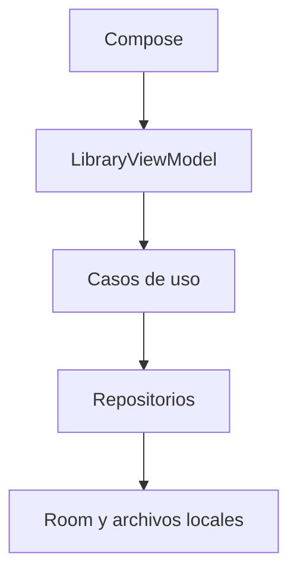

# Arquitectura de Lee.pe

Lee.pe es una aplicación Android offline-first. Los documentos se abren mediante
Storage Access Framework; las copias locales y los respaldos son acciones explícitas.

## Módulos

| Módulo | Responsabilidad |
|---|---|
| app | Entrada Android, navegación y composición de funciones |
| core/domain | Modelos y lógica Kotlin/JVM, progreso y cifrado local |
| core/database | Entidades, DAO, Room 3 y migraciones |
| core/datastore | Preferencias de la aplicación |
| core/ui | Componentes visuales compartidos |
| data | Repositorios, respaldo, almacenamiento offline y progreso |
| feature/library | Catálogo, búsqueda, organización, estadísticas y diálogos |
| feature/notes | Anotaciones |
| feature/sharecard | Tarjetas de citas |
| library/readium | Integración de lectura Readium |

La UI Compose observa estado de ViewModel. Los repositorios coordinan persistencia
y acceso a documentos; Room mantiene libros, colecciones, notas y sesiones.
El dominio no depende de Android. Los ajustes se gestionan mediante SettingsRepository.
El repositorio usa Room 3 (`androidx.room3`), no las coordenadas de Room 2.

## Integridad

Las migraciones son explícitas y conservan identidad y relaciones. El borrado usa
una cola persistente para completar la limpieza de archivos y preferencias cuando
el almacenamiento vuelve a estar disponible. Los respaldos restauran metadatos
sobre libros existentes; no conceden permisos SAF ni incluyen archivos originales.

El dominio contiene casos de uso de importación, borrado, progreso, búsqueda y
codificación/decodificación de respaldos, conectados a las rutas existentes.
LibraryScreen compone estado, catálogo y diálogos. Los selectores SAF conservan
su ciclo de vida Compose; no se crean ViewModels mediante `remember`.

La sincronización opcional, KMP y Paging 3 son posibles evoluciones, no capacidades
implementadas ni requisitos para usar el lector offline.
