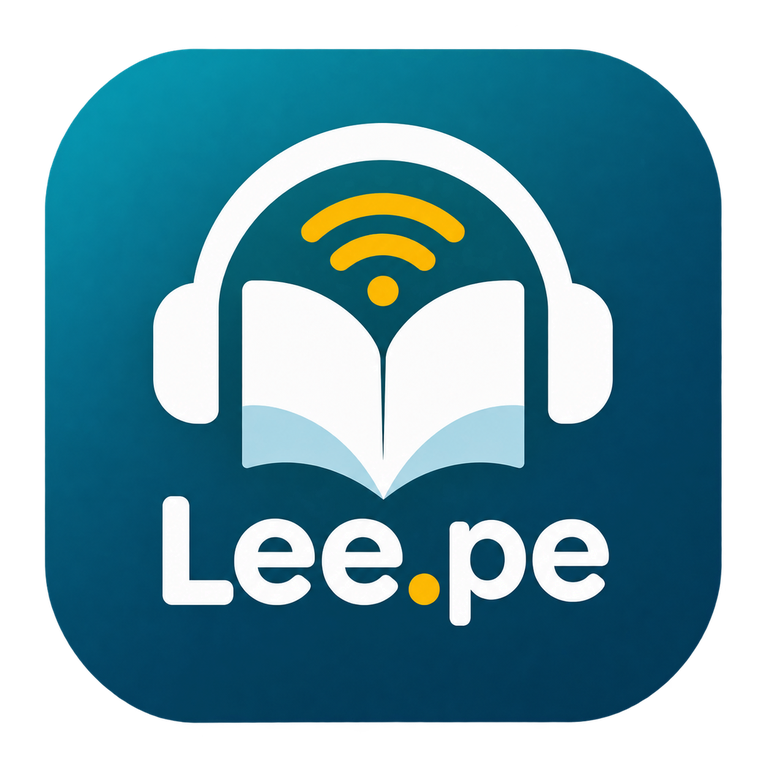
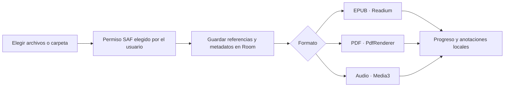
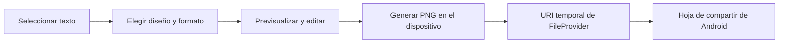
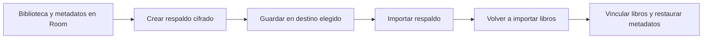
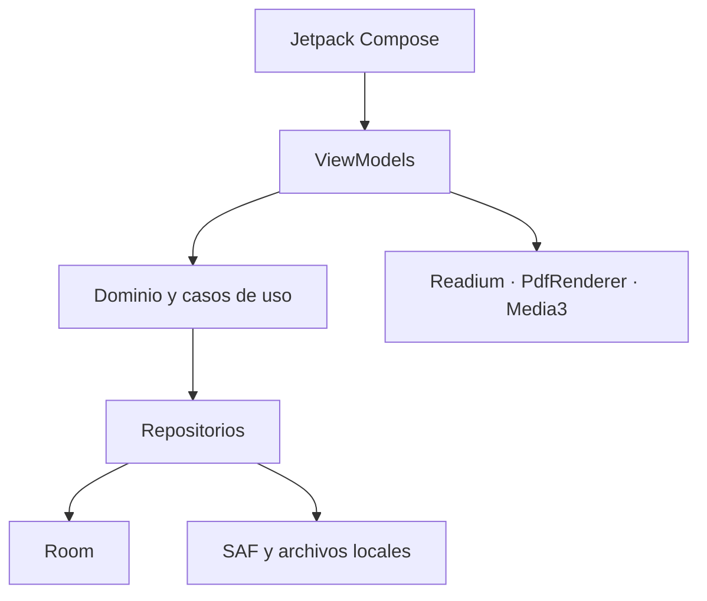

<p align="center">
  
</p>

<h1 align="center">Lee.pe</h1>
<p align="center"><strong>Lee, escucha y organiza tus libros desde tu dispositivo.</strong></p>

<p align="center">
  <a href="https://github.com/cponce123com-create/Lee.pe/actions/workflows/android-build.yml"></a>
  <a href="https://github.com/cponce123com-create/Lee.pe/actions/workflows/quality.yml"></a>
  
  
  <a href="LICENSE"></a>
</p>

<p align="center">
  <a href="#funciones">Funciones</a> ·
  <a href="#vistas-y-recursos-visuales">Vistas</a> ·
  <a href="#flujos">Flujos</a> ·
  <a href="#arquitectura">Arquitectura</a> ·
  <a href="#instalar-y-compilar">Compilar</a> ·
  <a href="#documentación">Documentación</a>
</p>

> **Estado del proyecto:** versión **0.3.7** (código 10), en desarrollo activo. La lectura local no necesita cuenta ni conexión. La reproducción en segundo plano y TTS están implementados en el código, pero todavía requieren validación en teléfonos físicos.

## Qué es Lee.pe

Lee.pe es un lector nativo para Android desarrollado con Kotlin y Jetpack Compose. Reúne biblioteca local, lectura de EPUB y PDF, audiolibros, narración con voz Android y tarjetas visuales para compartir citas. Los archivos se abren desde ubicaciones que la persona elige mediante el selector seguro de Android (SAF).

- **Android mínimo:** API 24 (Android 7.0).
- **SDK de compilación y destino:** API 36.
- **Privacidad:** no se necesita permiso de Internet para importar, leer, anotar, escuchar o exportar una tarjeta.
- **Sincronización en la nube:** no está implementada. Render, Neon y Cloudinary no son necesarios para usar la app.

## Funciones

| Área | Qué incluye | Estado |
|---|---|---|
| Biblioteca local | Importación múltiple, búsqueda por título/formato/colección, filtros, orden, cuadrícula o lista y progreso | Implementado |
| Escáner de carpetas | Búsqueda recursiva de EPUB, PDF y audio dentro de una carpeta autorizada por SAF | Implementado; requiere seleccionar la carpeta |
| Estantería | Portadas 3×3, nueve libros por página, y vista mixta de libros verticales y horizontales | Implementado |
| Personalización | Arrastrar libros y adornos, cambiar orientación y guardar el diseño; hasta 10 adornos colocados | Implementado |
| EPUB | Readium, índice, salto a porcentaje, paginación o desplazamiento, temas, tipografía, márgenes, marcadores, notas y resaltados | Implementado |
| PDF | Lector offline, zoom, rotación, salto/restauración de página, marcadores, notas y resaltados | Implementado; algunas herramientas requieren API 35 |
| Audio | Archivos locales, Media3 en segundo plano, controles del sistema y progreso guardado | Implementado en código; falta validación física |
| Narración EPUB | Readium y voces Android instaladas, resaltado del fragmento, velocidad y temporizador | Implementado en código; falta validación física |
| Tarjetas de citas | 50 plantillas, autor, marca Lee.pe y PNG en Historia, Cuadrado y Retrato | Implementado |
| Respaldo local | Archivo .leepebackup cifrado y compatibilidad con respaldos JSON antiguos | Implementado; no incluye los libros originales |

### Lectura de archivos

- **EPUB:** Readium conserva la posición con un locator estructural y porcentaje. Permite continuar, navegar por el índice, ajustar la apariencia, añadir marcadores, resaltar texto y tomar notas.
- **PDF:** PdfRenderer abre documentos locales. La selección y búsqueda requieren que el PDF tenga una capa de texto; la búsqueda está disponible desde Android 15 (API 35). Los documentos escaneados necesitan OCR, que no está incluido.
- **Audiolibros:** Media3 admite MP3, M4A, M4B, AAC, OGG, WAV y FLAC; la compatibilidad final depende del códec del dispositivo.
- **Libro de muestra:** una instalación limpia agrega el EPUB *El tesoro de los Incas*, de Emilio Salgari. Se guarda en el espacio privado de la app y puede eliminarse.

### Tarjetas para compartir

Al seleccionar una cita en un EPUB o en un PDF con texto, se puede abrir **Compartir como imagen**, elegir un diseño, editar la frase o el autor y usar la hoja de compartir de Android.

- 40 estilos existentes y 10 diseños editoriales añadidos.
- Tres formatos: Historia 1080×1920, Cuadrado 1080×1080 y Retrato 1080×1350.
- La frase, la atribución y el logotipo se dibujan al exportar; no están impresos en el fondo.
- El PNG se genera localmente y se comparte mediante un permiso temporal de FileProvider.
- La resolución de las texturas depende del atlas original; el texto y el logo se dibujan al tamaño de salida.
- No se publica nada automáticamente: la persona elige el destino en Android.

### Respaldo y recuperación

El archivo guarda datos de la biblioteca —progreso, anotaciones, marcadores, estadísticas y algunos ajustes—, pero **no contiene EPUB, PDF ni audio**. Para restaurar en otro dispositivo, hay que volver a importar los libros y luego vincular las coincidencias. Los permisos SAF también deben concederse de nuevo.

## Vistas y recursos visuales

El repositorio aún no contiene capturas completas de las pantallas tomadas en la app. Para no presentar mockups como si fueran screenshots reales, esta galería muestra recursos visuales originales que Lee.pe usa en el proyecto:

<table>
  <tr>
    <td align="center" width="50%">
      
      <br><strong>Estantería</strong><br>Fondo gráfico usado por la biblioteca.
    </td>
    <td align="center" width="50%">
      
      <br><strong>Adornos</strong><br>Recursos WebP transparentes para personalizar la estantería.
    </td>
  </tr>
  <tr>
    <td colspan="2" align="center">
      
      <br><strong>Tarjetas editoriales</strong><br>Los diez fondos incorporados en la versión 0.3.7. La app añade frase, autor y marca al exportar.
    </td>
  </tr>
</table>

> **Screenshots completos pendientes:** cuando se capturen desde un dispositivo real, añadirlos en docs/screenshots/ (por ejemplo: biblioteca, lector EPUB, lector PDF y editor de tarjetas). Si una función depende de la versión de Android, indicar también la API usada.

## Flujos

### Importar y leer sin subir libros



Lee.pe conserva acceso a las URI autorizadas. Si se revoca el permiso o se mueve el archivo original, la app pedirá seleccionarlo de nuevo. El escáner se ejecuta cuando la persona lo solicita; no copia los libros ni vigila cambios de forma permanente.

### Compartir una cita como PNG



### Exportar y restaurar un respaldo



## Arquitectura

La interfaz Compose observa el estado de ViewModels. Los casos de uso coordinan repositorios; Room conserva los datos de biblioteca y anotaciones. Las integraciones de lectura y medios se mantienen en módulos dedicados.



| Módulo | Responsabilidad |
|---|---|
| app | Entrada Android, navegación, actividades y servicios multimedia |
| core/domain | Modelos y reglas independientes de Android |
| core/database | Room y migraciones |
| core/datastore | Preferencias locales |
| core/ui | Componentes visuales compartidos |
| data | Repositorios, progreso, almacenamiento local y respaldos |
| feature/library | Biblioteca, búsqueda, estantería, adornos y escáner |
| feature/notes | Notas y anotaciones |
| feature/sharecard | Plantillas y exportación PNG |
| library/readium | Integración del toolkit Readium |
| benchmark | Macrobenchmarks; se incluye al activar la opción de benchmarks |

### Tecnologías

Kotlin · Jetpack Compose · AndroidX · Room 3 · Readium Kotlin Toolkit · Media3 · Storage Access Framework · Gradle Kotlin DSL.

## Instalar y compilar

### Requisitos

- JDK 21.
- Android SDK Platform 36.
- Android Gradle Plugin 9.3.1 y el Gradle Wrapper del repositorio.
- Android Studio compatible o un entorno con Android SDK instalado.

### Compilar localmente

```bash
git clone https://github.com/cponce123com-create/Lee.pe.git
cd Lee.pe
./gradlew lintDebug testDebugUnitTest :core:domain:test assembleDebug
```

El APK de depuración se genera en app/build/outputs/apk/debug/. En Windows se puede ejecutar gradlew.bat con los mismos argumentos.

### Descargar el APK de CI

1. Abre [Actions → Android debug APK](https://github.com/cponce123com-create/Lee.pe/actions/workflows/android-build.yml).
2. Elige una ejecución exitosa de main.
3. Descarga el artefacto lee-pe-debug-...
4. Revisa commit.txt, version.properties y SHA256SUMS para confirmar su origen.

Los APK release que CI genera sin secretos de firma están **sin firmar**; sirven para validar compilación, no para actualizar una app instalada. Consulta [Firma de APK](docs/FIRMA_APK.md).

## Calidad y validación

La automatización ejecuta compilación, lint, pruebas unitarias, validaciones del APK, pruebas instrumentadas en API 26 y API 35, y macrobenchmarks. La auditoría de dependencias se ejecuta en main y en ejecuciones manuales. Consulta el resultado del commit en [Actions](https://github.com/cponce123com-create/Lee.pe/actions).

Que el proyecto compile no demuestra por sí solo el comportamiento en un teléfono. La reproducción en segundo plano, TTS, selección de texto PDF, restauración y entrega a apps externas requieren validación manual; los pasos están en la [guía de validación](docs/VALIDACION_ANDROID.md).

## Documentación

| Guía | Contenido |
|---|---|
| [Arquitectura](ARCHITECTURE.md) | Módulos y límites |
| [Escáner local](docs/ESCANER_LOCAL.md) | SAF, formatos y límites del escaneo |
| [Estantería](docs/LIBRARY_3D.md) | Disposición, adornos y persistencia |
| [Interacciones de biblioteca](docs/LIBRARY_INTERACTIONS.md) | Portadas 3×3, arrastre y vista mixta |
| [Tarjetas premium](docs/TARJETAS_PREMIUM.md) | Diez diseños editoriales, formatos y calidad de imagen |
| [Compartir tarjetas](docs/COMPARTIR_TARJETAS.md) | Flujo PNG, hoja de compartir y límites |
| [Respaldo local](docs/RESPALDO_LOCAL.md) | Cifrado, importación y restauración |
| [Compilar](docs/BUILD.md) | Variantes y artefactos |
| [Calidad](docs/QUALITY.md) | Lint, pruebas, cobertura y benchmarks |
| [Validación Android](docs/VALIDACION_ANDROID.md) | Pruebas manuales en dispositivos |
| [Arquitectura offline-first](docs/ARQUITECTURA_OFFLINE_FIRST.md) | Principios y sincronización futura |

## Privacidad

- Los libros se abren desde una URI elegida por la persona o desde una copia local explícita.
- Lee.pe no sube libros automáticamente ni depende de una cuenta.
- Las tarjetas se renderizan en el dispositivo y se comparten solo después de elegir una app receptora.
- El respaldo se guarda donde la persona elija y no contiene los archivos originales.
- La copia de seguridad automática de Android está desactivada; exporta un respaldo manual antes de reinstalar o cambiar de teléfono.
- No se necesita permiso general de almacenamiento ni cámara para escanear carpetas. El escáner no realiza OCR.

## Licencias

El código de Lee.pe se distribuye bajo Apache License 2.0. Consulta [NOTICE](NOTICE) para las licencias y avisos de dependencias y recursos de terceros.
