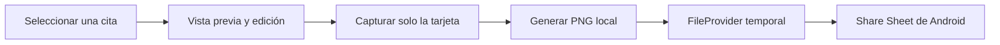

# Compartir tarjetas de citas

Lee.pe permite convertir una selección del lector EPUB o de un PDF con texto en una imagen PNG lista para compartir. La generación y el archivo temporal ocurren en el dispositivo; no se envían libros ni citas a servicios en línea.

## Flujo



## Contratos

- `ShareCardGenerator` recibe el modelo de la cita, los píxeles ARGB capturados por Compose y el formato; devuelve bytes PNG. El contrato usa tipos Kotlin puros y no expone `Bitmap` del framework Android.
- `ShareCardSharer` escribe el PNG en `cacheDir/quotecards` y abre el Share Sheet con `ACTION_SEND`, tipo `image/png` y permiso temporal de lectura.
- `ShareCardArgs` transporta texto, identificador local del libro, título, autor y Locator JSON cuando el lector lo conoce.

## Temas incluidos

1. **Papel:** crema y tipografía serif.
2. **Noche:** negro OLED y texto claro.
3. **Acento:** degradado cálido con texto oscuro.

Para añadir un tema, agrega un identificador a `QuoteCardThemeId`, define su paleta en `ui/theme/QuoteCardTheme.kt`, incorpora una etiqueta en `res/values/strings.xml` y cubre su selección en la prueba de pantalla. Revisa que el contraste siga siendo legible.

## Formatos

- **Historia:** 1080 × 1920 px, proporción 9:16.
- **Cuadrada:** 1080 × 1080 px.

Para añadir otro formato, agrégalo a `QuoteCardFormat`, añade su selector y ajusta la proporción de la vista previa. La implementación escala el raster capturado al tamaño final en segundo plano.

## Limitaciones conocidas

- El autor se obtiene de los metadatos de publicación EPUB cuando Readium lo proporciona. El visor PDF actual no expone autor; el usuario puede completar o corregir ese campo en “Editar frase”.
- En PDF escaneados sin capa de texto no habrá selección disponible; OCR no forma parte de esta función.
- Las tarjetas aún no se guardan en galería ni en Room. La primera versión solo genera una copia temporal para compartir; los PNG temporales antiguos se limpian al crear otra tarjeta.
- La pantalla actual de lectura está en `app`; la acción se integra allí sin mover el lector a `feature:reader`.
- La app todavía no usa Hilt. Este módulo recibe sus dependencias mediante una factoría manual desde `ShareCardActivity` para no introducir un contenedor global adicional.

## Validación

```bash
./gradlew :feature:sharecard:testDebugUnitTest
./gradlew :feature:sharecard:connectedDebugAndroidTest
./gradlew lintDebug testDebugUnitTest assembleDebug
```

En un teléfono, validar selección y creación desde EPUB y PDF con texto, los tres temas, ambos formatos, cancelación del Share Sheet, envío por WhatsApp/otra app y permiso de lectura del PNG compartido.
