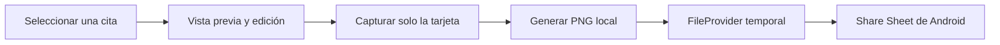

# Compartir tarjetas de citas

Lee.pe permite convertir una selección del lector EPUB o de un PDF con texto en una imagen PNG lista para compartir. La generación y el archivo temporal ocurren en el dispositivo; no se envían libros ni citas a servicios en línea.

## Flujo



## Contratos

- `ShareCardGenerator` recibe el modelo de la cita, los píxeles ARGB capturados por Compose y el formato; devuelve bytes PNG. El contrato usa tipos Kotlin puros y no expone `Bitmap` del framework Android.
- `ShareCardSharer` escribe el PNG en `cacheDir/quotecards` y abre el Share Sheet con `ACTION_SEND`, tipo `image/png` y permiso temporal de lectura.
- `ShareCardArgs` transporta texto, identificador local del libro, título, autor y Locator JSON cuando el lector lo conoce.

## Plantillas incluidas

La galería incluye 40 opciones editables, organizadas con los nombres de las referencias: marfil editorial, noche literaria, papel y tinta, subrayado, bosque, mar en calma, atardecer, lluvia, acuarela, botánica, flores secas, cielo nocturno, tipografía protagonista, revista, degradado, geometría, Polaroid, carta, página de libro, biblioteca, libro antiguo, papiro, piedra tallada, mármol y oro, arcilla, pergamino real, tinta japonesa, cianotipo, cristal, cromo, aura, recortes, grabado en madera, bordado, azulejos, cartel retro, museo, jardín de musgo, arena y relieve blanco.

Las variaciones se dibujan en Compose con paletas, marcos, líneas, figuras y texturas vectoriales. El texto y el pie se generan en tiempo de ejecución, así que las frases del lector no quedan pegadas a una imagen de muestra. No se descargan recursos ni se envían datos a internet.

Para añadir una plantilla, agrega su identificador a `QuoteCardThemeId`, define su paleta y patrón en `ui/theme/QuoteCardTheme.kt`, incorpora el nombre en `values/strings.xml` y `values-en/strings.xml`, y añade la etiqueta a `ThemeSelector`. Revisa contraste y ajuste de frases largas.

## Formatos

- **Historia:** 1080 × 1920 px, proporción 9:16.
- **Cuadrada:** 1080 × 1080 px.

Para añadir otro formato, agrégalo a `QuoteCardFormat`, añade su selector y ajusta la proporción de la vista previa. La implementación escala el raster capturado al tamaño final en segundo plano.

## Limitaciones conocidas

- La imagen exportada muestra únicamente la frase, el autor y la marca Lee.pe. El título del libro no aparece en la tarjeta. El autor se obtiene de los metadatos EPUB cuando Readium lo proporciona; en PDF el usuario puede completarlo o corregirlo en “Editar frase”.
- En PDF escaneados sin capa de texto no habrá selección disponible; OCR no forma parte de esta función.
- Las tarjetas aún no se guardan en galería ni en Room. La primera versión solo genera una copia temporal para compartir; los PNG temporales antiguos se limpian al crear otra tarjeta.
- La pantalla actual de lectura está en `app`; la acción se integra allí sin mover el lector a `feature:reader`.
- La app todavía no usa Hilt. Este módulo recibe sus dependencias mediante una factoría manual desde `ShareCardActivity` para no introducir un contenedor global adicional.

## Validación

```bash
./gradlew :feature:sharecard:testDebugUnitTest
./gradlew :feature:sharecard:connectedDebugAndroidTest
./gradlew lintDebug testDebugUnitTest assembleDebug
```

En un teléfono, validar selección y creación desde EPUB y PDF con texto, las 40 plantillas, ambos formatos, cancelación del Share Sheet, envío por WhatsApp/otra app y permiso de lectura del PNG compartido.

## Estabilización previa a distribución (2026-11-03)

- La captura forma parte del manejo de errores del ViewModel: un fallo de captura o codificación permite reintentar y no debe cerrar la pantalla.
- La reserva de generación es síncrona. Pulsaciones repetidas no crean exportaciones adicionales; mientras se genera se ignoran cambios de texto, metadatos, tema y formato.
- Pruebas añadidas: fallo de captura y reintento; pulsaciones repetidas y estabilidad del contenido durante generación. Los tests de UI desplazan los controles antes de pulsarlos para funcionar en pantallas pequeñas.
- CI conserva los informes de lint, pruebas unitarias e instrumentadas incluso si una etapa falla. Consultar el artefacto `android-validation-reports`.
- La ejecución local está bloqueada por la descarga de Gradle (`Network is unreachable`). No equivale a pruebas aprobadas: consultar el resultado de Actions del commit exacto.

Pendiente en dispositivo: compartir y volver desde el selector de apps, pulsar repetidamente, girar durante generación y probar con tamaño de fuente grande en un teléfono pequeño y otro grande.

Limitaciones pendientes de corregir antes de producción: las citas largas pueden mostrar puntos suspensivos; el raster de vista previa se escala a 1080 píxeles, por lo que la nitidez depende de la pantalla. No se considera validada la exportación de citas extensas ni el rendimiento en dispositivos con poca memoria.

## Plantillas y exportación

La tarjeta se compone a 1080 píxeles de ancho. La vista en pantalla se escala, pero la captura conserva los píxeles originales. La frase y el nombre del autor se miden por separado y reducen su tipografía hasta el mínimo legible configurado; si el contenido todavía no cabe, Compartir queda deshabilitado y se pide cambiar a Historia o editar la frase. El título se conserva como metadato interno, pero no se dibuja.

La opción del lector se llama **Compartir como imagen**. Mantén pulsado un fragmento del EPUB; según el menú del sistema puede aparecer directamente o dentro de los tres puntos. Los colores se personalizan eligiendo plantilla; no se incluye un selector libre de colores.
